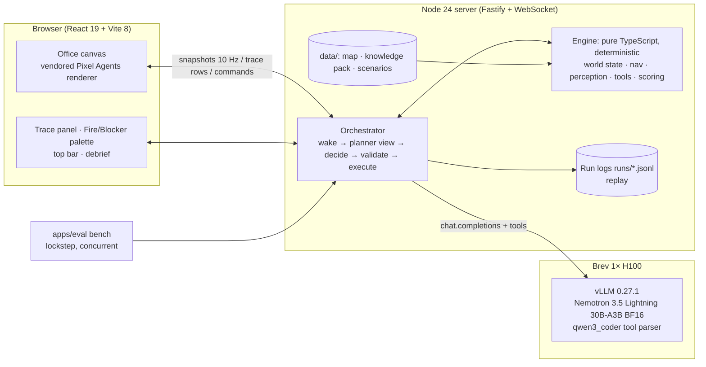

# Escape from Red Hat

**A pixel-art workplace evacuation exercise where you change the emergency and watch AI-controlled characters respond.**

- **The setting.** A fictional Red Hat conference room connects to an NVIDIA-themed lobby, two ground-level exits and an assembly point.
- **The model.** A single small open model, **NVIDIA Nemotron 3.5 Lightning 30B-A3B** served with **vLLM**, acts as a *central planner*. It picks real, validated tool calls for three characters:
  - Alex, the warden;
  - Maya, an employee;
  - Daniel, a visitor who uses a wheelchair.
- **What you do.** Drag in a **fire**, then a **blocker**.
- **What you see.** The model reports the hazard and honours Daniel's buddy arrangement. When a route is suddenly unavailable it recovers, and it verifies everyone at the assembly point. Every proposal and result appears in a live trace.
- **What the engine guarantees.** A deterministic engine owns the world. The model can't walk anyone through a hazard or declare success; only a verified roster can.

Main track: **Tool-Calling**. Built at the NVIDIA × Red Hat Small Models Hack, Raleigh, Oct 17–18 2026.

- Demo video: _link to be added_ (unlisted YouTube)
- Screenshot: _to be added_ (`docs/screenshot.png`)

> **What we claim, and what we don't.**
> - We claim tool-use reliability of a small model in a simulated exercise.
> - We do **not** claim training effectiveness, realistic human behaviour, fire dynamics, building-code compliance, or an operational emergency system.

---

## Quick start

Requirements: Node ≥ 20 (tested on 24) and npm. A GPU is only needed to self-host the model (see below).

```bash
npm ci
cp .env.example .env          # PLANNER_PROVIDER=scripted works with no key
npm run data:map              # rebuild data/maps/office-v1.json (already committed)
npm run dev                   # server :8787 + web :5173
open http://localhost:5173
```

**Two modes.** Scripted mode is a labeled fixture: the UI says **SCRIPTED — not a model**. Use it for UI work only. For the real planner, point `.env` at Nemotron (see [Reproduce the demo](#how-to-reproduce-the-demo)).

**Other commands:**

```bash
npm test                      # engine + server tests (vitest)
npm run data:scenarios        # regenerate the scenario dataset (deterministic)
npm run bench -- --split dev  # headless benchmark → results/<run>/summary.md
npm run replay -- runs/<episodeId>.jsonl   # re-simulate a saved run and check it reproduces
npm run build && npm start    # production: server also serves the built web app
```

## Tech stack and architecture



| Component | What it does |
|---|---|
| `packages/contracts` | Shared types; 9 tool JSON Schemas (sent to the model) and zod validators (enforced); WebSocket protocol |
| `packages/engine` | Authoritative simulation: 100 ms ticks, 4-connected pathfinding, wheelchair-clearance mask, line-of-sight perception, tool validation and effects, outcomes, metrics, debrief, state hash. No I/O, seeded RNG only |
| `apps/server` | Fastify + `@fastify/websocket`. Episode lifecycle (pause/reset/replay), the planner loop, decision providers (`openai-compatible` for vLLM / NVIDIA API Catalog, plus a labeled `scripted` fixture), prompt and harness, run logs |
| `apps/web` | React 19 + Vite 8. Pixel Agents' Canvas 2D renderer (vendored @3537e14, patched so the engine drives every character). Overlays for names, speech bubbles and the placement ghost; trace; palette (drag-drop, click-to-place, keyboard) |
| `apps/eval` | Headless benchmark, replay checker, baseline-versus-final comparison |
| `data/` | Map (ASCII to JSON), knowledge pack (OSHA / NC DOL, paraphrased with links), synthetic scenario dataset |
| `deploy/vllm` | `serve.sh`, `check.sh`, Brev runbook, model manifest |

**Tools the model can call:** `observe`, `consult_plan`, `notify`, `plan_route`, `move`, `request_assistance`, `assist`, `check_in`, `verify_roster`.

- Invalid calls return structured errors and never change the world. Codes include `ROUTE_UNAVAILABLE`, `STALE_STATE`, `ACTOR_BUSY`, `OUT_OF_RANGE`, `ASSISTANCE_NOT_ACCEPTED` and `NOT_AUTHORIZED`.
- The planner sees each character's observations and reports, but never hazards nobody has seen.
- Each character can only act on what *they* know. Someone who hasn't been told about the fire can't evacuate until someone notifies them.

**Rendering.** A fixed ¾-view pixel diorama, top-down with z-sorting. It is not isometric or 3D.

## How to reproduce the demo

### 1. Serve the model (self-hosted, used for the submitted demo and results)

On a Brev GPU (1× H100 80–96 GB recommended), follow [`deploy/vllm/README.md`](deploy/vllm/README.md):

```bash
docker run -d --gpus all --ipc=host -p 8000:8000 -v ~/.cache/huggingface:/root/.cache/huggingface \
  vllm/vllm-openai:v0.27.1 --model nvidia/NVIDIA-Nemotron-3.5-Lightning-30B-A3B-BF16 --revision <sha> \
  --served-model-name nemotron-3.5-lightning --max-model-len 16384 --max-num-seqs 32 \
  --enable-prefix-caching --async-scheduling --mamba-backend flashinfer --mamba-ssm-cache-dtype float16 \
  --enable-mamba-cache-stochastic-rounding --mamba-cache-philox-rounds 5 \
  --reasoning-parser nemotron_v3 --tool-call-parser qwen3_coder --enable-auto-tool-choice \
  --api-key $VLLM_API_KEY
# from the laptop:
ssh -N -L 8000:localhost:8000 <brev-instance>
```

Development fallback with the same weights: the hosted NVIDIA API Catalog (see env table below). Results from it are labeled "hosted".

### 2. Configure `.env` (keys stay on the server; the browser never sees them)

| Variable | Example | Meaning |
|---|---|---|
| `PLANNER_PROVIDER` | `openai-compatible` | `scripted` = labeled fixture, not a model |
| `PLANNER_BASE_URL` | `http://localhost:8000/v1` | vLLM (via tunnel). Hosted: `https://integrate.api.nvidia.com/v1` |
| `PLANNER_MODEL` | `nemotron-3.5-lightning` | vLLM `--served-model-name`. Hosted: `nvidia/nemotron-3.5-lightning-30b-a3b` |
| `PLANNER_API_KEY` | `<VLLM_API_KEY>` | vLLM `--api-key`, or an `nvapi-…` key for the hosted catalog |
| `PLANNER_ENDPOINT_KIND` | `self-hosted-vllm` | or `hosted-api`; shown in the UI and in results |
| `PLANNER_LABEL` | `Nemotron 3.5 Lightning 30B-A3B` | display name |
| `PLANNER_THINKING` | `false` | reasoning off for latency (A/B option) |
| `PLANNER_TEMPERATURE` / `PLANNER_TOP_P` | `0.6` / `0.95` | sampling |
| `PLANNER_MAX_TOKENS` | `1024` | per decision (raise if thinking is on) |
| `PLANNER_DEADLINE_MS` | `20000` | per-decision timeout |
| `PLANNER_MAX_DECISIONS` | `24` | episode decision cap |
| `PLANNER_HARNESS` | `v2` | prompt/harness version (`v1` = baseline) |
| `PORT` | `8787` | server port |
| `DEMO_CASE` | `demo-hero` | scenario loaded on start/reset |

### 3. Run the hero scenario

1. `npm run dev`, then open http://localhost:5173. Check that the top bar shows **Nemotron · self-hosted vLLM** and that the model is healthy.
2. Watch the idle office. No model calls happen before an incident.
3. Drag **Fire** onto the floor just inside **door A** (top wall of the Red Hat room), next to Maya.
4. Maya sees it. Follow the trace: **Nemotron planner → Maya → notify**, then the assistance arrangement (Daniel requests Alex, Alex joins him and assists), then moves.
5. When Alex and Daniel enter the NVIDIA lobby heading for the east exit, drag **Blocker** into the **south branch** corridor.
6. Their move stops safely with `ROUTE_UNAVAILABLE`. The model reports the blockage, re-plans through the lobby connector, the north corridor and the west exit, checks everyone in, and Alex runs `verify_roster`.
7. Read the debrief. Use **Reset** to start again.

**Replay a saved run** (labeled **REPLAY** in the UI): `npm run replay -- runs/demo-hero.jsonl`. This re-applies the recorded decisions without calling the model.

**Benchmark:** `npm run bench -- --split test --provider env --concurrency 4 --out results/test-v2`.

## Datasets and synthetic data (with provenance)

| Data | Type | Provenance and licence | How it is used |
|---|---|---|---|
| `data/scenarios/` **escape-office-scenarios-v1** | **Synthetic**, generated during the event (2026-10-17) | `generator.ts`, master seed 20261017. Method, fields and limits are in [`DATASET_CARD.md`](data/scenarios/DATASET_CARD.md); hashes in `provenance.json`. CC BY 4.0 | The app boots `demo-hero`. The benchmark runs and scores 16 dev and 16 held-out test cases (test uses fire locations never seen in dev) |
| `data/maps/office-v1` | Synthetic (authored) | `office-v1.ascii` plus `build-map.ts`. Furniture footprints come from the vendored Pixel Agents manifests | Shared by the engine (navigation truth) and the renderer |
| `data/knowledge/` | Paraphrased public sources | 29 CFR 1910.36(d)(1), 1910.37(a)(3), 1910.38(c)–(f) (U.S. government works); OSHA *Getting Started* guidance; NC DOL EAP pages. Each card has a source URL, checked 2026-10-17. The site plan is **fictional** | `consult_plan` answers and the debrief's cited lessons |

**Considered but not integrated:** LEMTA evacuation drills, Jülich bottleneck trajectories, NIST stair egress, and Raleigh building footprints. Reasons are in the dataset card. No real measurement is presented as describing this office.

## Results

**Pending measurement.** Tables will be filled from `results/` runs on the self-hosted vLLM endpoint. Nothing here is estimated.

| Run | Split | Provider | Success on solvable | False success on unsolvable | Invalid-call rate | Recoveries | Decision p50 / p95 |
|---|---|---|---|---|---|---|---|
| _pending_ | dev (16) | Nemotron via vLLM (Brev H100) | — | — | — | — | — |
| _pending_ | test (16, held-out) | Nemotron via vLLM (Brev H100) | — | — | — | — | — |

## How NVIDIA Nemotron, vLLM and NeMo Gym are used

**Nemotron 3.5 Lightning 30B-A3B** is the only generative model; 30B total parameters is within the 33B cap.
- It is the central planner: each decision is one native tool call for one named character.
- We chose it because it is a small open model with native tool calling. Its 3B-active MoE keeps per-decision latency low enough for a live scene.
- How we get the most out of it:
  - compact planner view of about 1K tokens;
  - strict schemas;
  - structured, recoverable errors with hints;
  - thinking off by default, with an on/off A/B available;
  - a decision cap.

**vLLM 0.27.1** serves the model on one Brev GPU through the OpenAI-compatible API.
- Native tool calls come from the `qwen3_coder` parser, and reasoning separation from `nemotron_v3`.
- Prefix caching helps because the system prompt and tool schemas are a shared prefix. A modest 16K context is enough.
- The benchmark runs many headless episodes concurrently, which is the throughput workload vLLM batches. Measurements are recorded in `deploy/vllm/MODEL_MANIFEST.md` and `results/`.
- We use upstream vLLM because Red Hat AI Inference 3.5.1 packages vLLM 0.24.0, older than this model requires.

**NeMo Gym is not built yet.** It is an optional extension: a Resources Server wrapping this same engine, with `verify()` returning the engine score. No weight training (RL) was done.

## Known limitations and next steps

**Limitations:**
- One fictional single-level map, with three characters, one fire and one blocker.
- No fire spread, smoke, injury or crowd dynamics.
- Perception and smoke-notice rules are simple deterministic rules.
- A central planner controls all three characters. These are not independent agents, and we make no claim that a multi-agent setup is better.
- Benchmark: 32 synthetic cases, a single run per case, temperature > 0. Treat differences of one or two cases as noise.
- Educational value is a hypothesis; no learning outcomes were measured. Not compliance training; no building-code claims.
- Replays re-apply recorded decisions. A fresh run with the same seed can make different model choices.

**Next steps:**
- Import a customer's own floor plan.
- More hazard types and occupants.
- A NeMo Gym environment, with baseline-versus-final results on the held-out split.
- RL fine-tuning of a warden policy, once trainer and hardware compatibility is confirmed.
- A study of whether watching runs actually helps people learn.

## Team

| Name | Role | Contact |
|---|---|---|
| _to fill_ | Engine / planner lead | _to fill_ |
| _to fill_ | Inference / evaluation lead | _to fill_ |
| _to fill_ | Frontend / visual lead | _to fill_ |

## Licences and attribution

- Our code: MIT ([LICENSE](LICENSE)). Scenario dataset: CC BY 4.0.
- Pixel Agents renderer and assets: MIT © 2026 Pablo De Lucca, vendored at commit `3537e14`. Character sprites are based on JIK-A-4 *Metro City* (CC0).
- Fonts (Inter, Pixelify Sans): OFL 1.1.
- Full details: [THIRD_PARTY_NOTICES.md](THIRD_PARTY_NOTICES.md).

**Trademark notice.** "Red Hat" and "NVIDIA" are trademarks of their owners. This is a fictional, hackathon-themed office, **not** affiliated with or endorsed by Red Hat or NVIDIA, and not an official training product.

## Hackathon rule compliance

| Rule | How we meet it |
|---|---|
| Code written during the event | All project code was written during the event, starting 2026-10-17 |
| Reused open source must be ≥ 2 weeks old | Pixel Agents is pinned to commit `3537e14` (2026-08-15). The vLLM image is `v0.27.1` (released 2026-08-11). npm dependencies resolve with `before=2026-10-03` in `.npmrc`; check with `npm run deps:audit` |
| ≤ 33B total generative parameters | One model, 30B total. No draft, critic or router models (`deploy/vllm/MODEL_MANIFEST.md`) |
| Meaningful open data | The published synthetic scenario dataset (with method), which drives the app and the scorer, plus the source-linked public knowledge pack |
