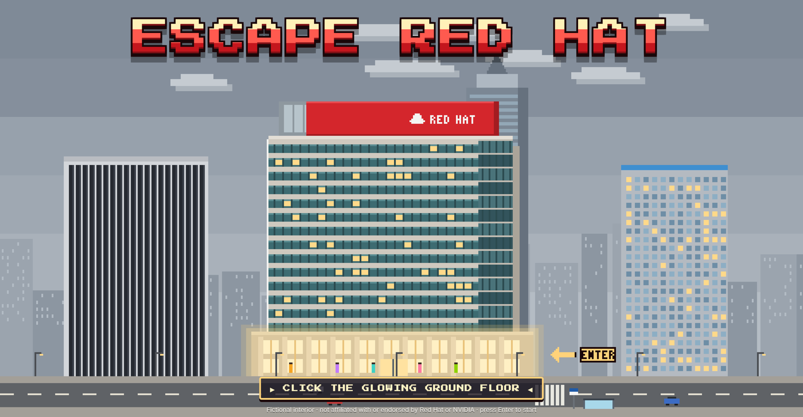
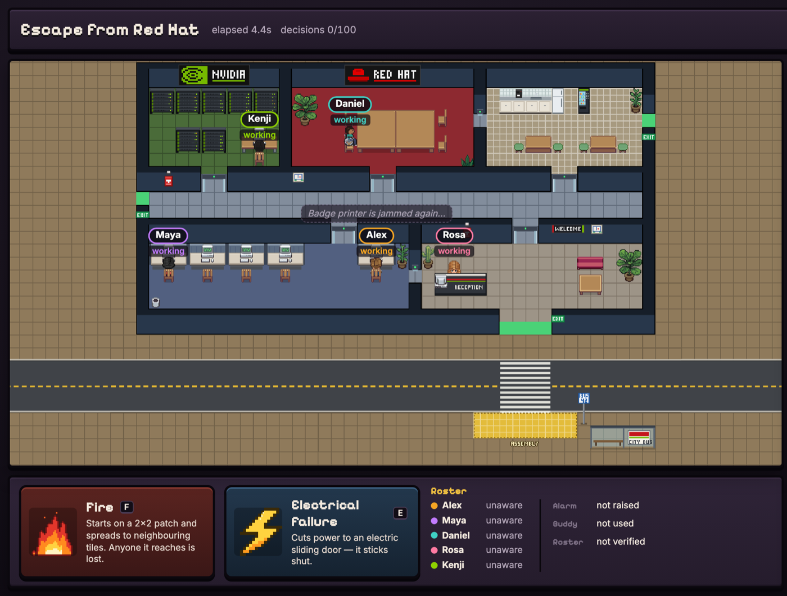
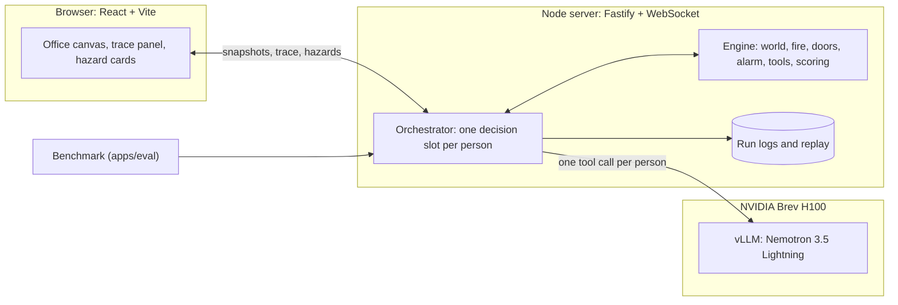

<p align="center">
  
</p>

<h1 align="center">Escape from Red Hat</h1>

<p align="center">
  <b>A pixel-art office evacuation drill. You start the fire and cut the power. NVIDIA Nemotron gets five people out through validated tool calls.</b>
</p>

<p align="center">
  <a href="https://huggingface.co/nvidia/NVIDIA-Nemotron-3.5-Lightning-30B-A3B-BF16"></a>
  <a href="deploy/vllm/serve.sh"></a>
  <a href="https://developer.nvidia.com/brev"></a>
  
</p>
<p align="center">
  
  
  
  
  
  <a href="LICENSE"></a>
  <a href="data/scenarios/DATASET_CARD.md"></a>
</p>

<p align="center">
  <a href="#quick-start">Quick start</a> ·
  <a href="#tech-stack-and-architecture">Tech stack</a> ·
  <a href="#how-to-reproduce-the-demo">Reproduce the demo</a> ·
  <a href="#datasets-and-synthetic-data">Datasets</a> ·
  <a href="#known-limitations-and-next-steps">Limitations</a>
</p>

---

A deterministic TypeScript engine owns a fictional office ground floor: six rooms, seven electric sliding doors, three exits, two fire-alarm pull stations, and a street with a bus-stop assembly point. You drop fires and power cuts. Each of the five people (Alex the warden, Maya, Daniel who uses a wheelchair, Rosa at reception and Kenji in IT) is a separate **Nemotron 3.5 Lightning 30B-A3B** agent, self-hosted on **vLLM**, deciding from only what that person has seen, heard or been told. The engine validates every tool call against the true world state, and a run only succeeds when every survivor is physically at the assembly point and the warden has verified the roster.

<p align="center">
  
</p>

- **Five independent agents.** One Nemotron call per person, each with a strictly personal view and reasoning capped at 128 tokens. All five decide in parallel, about 1.1 s per decision on one H100.
- **No hard-coded reflexes.** Warning the room, pulling the alarm, helping Daniel and choosing an exit are each person's own decision. The engine only simulates the world: fire, doors, sight and earshot.
- **Honest by construction.** Rejected calls change nothing and return an error code with a hint. Nobody can declare success; only the warden's verified roster can end a run as one.
- **Measured.** On 14 held-out scenarios, everyone got out in 12, and no run ever claimed a false success ([summary](results/2026-10-18-office-v2-vllm-h100/agents-test/summary.md)).

## Demo

https://youtu.be/A8X2oErT1Oc

## Quick start

Requires Node 20 or newer (tested on 24) and npm. A GPU is only needed to self-host the model.

```bash
npm ci
cp .env.example .env    # runs a labelled scripted fixture by default, no key needed
npm run dev             # server on :8787, web app on :5173
```

Open http://localhost:5173 and click the glowing ground floor. To use Nemotron instead of the fixture, see [How to reproduce the demo](#how-to-reproduce-the-demo).

| Command | What it does |
|---|---|
| `npm test` | Engine and server tests (vitest) |
| `npm run bench -- --split test --provider env --mode agents --out results/<dir>` | Headless benchmark on a dataset split |
| `npm run replay -- runs/demo-hero.jsonl` | Re-simulate a saved run without calling the model |
| `npm run data:map` / `npm run data:scenarios` | Rebuild the map / regenerate the scenario dataset (deterministic) |
| `npm run build && npm start` | Production build, served by the game server |

## Tech stack and architecture

| Layer | Technology |
|---|---|
| Model | NVIDIA Nemotron 3.5 Lightning 30B-A3B (BF16), the only generative model |
| Serving | vLLM 0.27.1 on one NVIDIA Brev H100 80GB, OpenAI-compatible API, `qwen3_coder` tool-call parser |
| Simulation | Pure, deterministic TypeScript engine (seeded fire spread, doors, alarm, pathfinding, perception, scoring) |
| Server | Node 24, Fastify, WebSocket |
| Web | React 19, Vite, Canvas 2D (vendored Pixel Agents renderer) |
| Evaluation | Headless benchmark and replay checker |



**One decision:** the engine wakes a person when they notice something new (a fire, a warning, the siren, a dead door). Their prompt holds only what they know, and Nemotron returns one tool call for that person (`observe`, `consult_plan`, `notify`, `plan_route`, `move`, `request_assistance`, `assist`, `check_in`, `verify_roster`, `pull_alarm`). Everyone who is ready decides at the same time; the engine executes each call or rejects it with a reason.

```
apps/server       Fastify + WebSocket server, orchestrator, prompts, model providers
apps/web          React UI: canvas renderer, trace panel, hazard cards, roster
apps/eval         Benchmark, replay checker, comparison tool
packages/engine   Deterministic simulation (no I/O)
packages/contracts  Shared types, tool schemas, WebSocket protocol
data/             Map, synthetic scenario dataset, safety knowledge cards
deploy/vllm/      serve.sh, check.sh, model manifest
docs/             Serving and tool-calling details, demo runbook, images
results/          Benchmark summaries and replayable run logs
runs/             Saved live runs (demo-hero.jsonl is the backup replay)
```

Serving flags, latency and tool-calling details: [`docs/tech-stack.md`](docs/tech-stack.md).

## How to reproduce the demo

Two ways: watch our recorded run (no GPU needed), or run it live against Nemotron.

### Option A: watch the recorded demo

1. Start the app as in [Quick start](#quick-start). The default `.env` is enough, because a replay never calls the model.
2. Open http://localhost:5173, enter the ground floor, and pick **Recorded demo run** from the **Replay a saved run** menu in the top bar.

It plays back a real run of the five Nemotron agents recorded on our vLLM server (a fire in the cubicles, then a power cut on the reception door). It is identical every time and marked with a REPLAY badge. To check from the terminal that it reproduces exactly: `npm run replay -- runs/demo-hero.jsonl`.

### Option B: run it live with Nemotron

**1. Serve the model** on a Brev GPU VM (we used 1x H100 80GB). The API key is generated on the VM and never committed.

```bash
# On the VM: vLLM 0.27.1 with the exact flags used for the demo and results
./deploy/vllm/serve.sh
# On the laptop that runs the game server (keep it open)
brev port-forward escape-nemotron --port 8001:8000
```

**2. Configure `.env`** (sample below; full list in [`.env.example`](.env.example)). Keys stay on the server; the browser never receives them.

```dotenv
PLANNER_PROVIDER=openai-compatible
PLANNER_BASE_URL=http://127.0.0.1:8001/v1
PLANNER_MODEL=escape-nemotron
PLANNER_API_KEY=<ESCAPE_VLLM_KEY from the VM's server.env>
PLANNER_ENDPOINT_KIND=self-hosted-vllm
PLANNER_LABEL="Nemotron 3.5 Lightning 30B-A3B"
PLANNER_MODE=agents             # one Nemotron call per person
```

| Variable | Default | Purpose |
|---|---|---|
| `PLANNER_API_KEY` | none | The vLLM `--api-key`, or an `nvapi-` key for the hosted NVIDIA API Catalog fallback |
| `PLANNER_BASE_URL` / `PLANNER_MODEL` | vLLM tunnel | Hosted fallback: `https://integrate.api.nvidia.com/v1` and `nvidia/nemotron-3.5-lightning-30b-a3b` |
| `PLANNER_AGENT_THINKING_BUDGET` | `128` | Reasoning tokens per decision (`0` = no cap) |
| `PLANNER_AGENT_MAX_DECISIONS` | `250` | Safety stop per run, all five people combined (there is no game timer) |
| `PLANNER_AGENT_FREEZE_WHILE_THINKING` | `true` | Hold the sim clock while anyone thinks; `false` for real-time pressure |
| `DEMO_CASE` | `demo-hero` | Scenario loaded on start and reset |

**3. Run it.**

1. `npm run dev` and open http://localhost:5173. The server log should report `health: OK` for the model.
2. Optionally drag **Electrical Failure** onto a sliding door on someone's way out, such as the reception door (`node scripts/auto-electrical.mjs` cuts it on cue).
3. Drag **Fire** anywhere inside the building. Our recording put it in the cubicles next to Maya.
4. Watch each person decide from what they know: who notices, who warns the room, who goes for a pull station, which exit they take. Every call and its reasoning appear in the trace.
5. The run ends once every survivor has checked in at the bus stop and Alex has verified the roster.

Each person is a separate model call, so routes, timing and who does what differ from run to run. The recorded demo is one such run.

## Datasets and synthetic data

| Data | Type | Provenance | Used for |
|---|---|---|---|
| [`data/scenarios/`](data/scenarios/DATASET_CARD.md) `escape-office-scenarios-v3` | Synthetic, generated during the event | `generator.ts` v3, master seed 20261017; 16 dev and 16 test cases with disjoint fire rooms; method, labels and hashes in the [dataset card](data/scenarios/DATASET_CARD.md) and `provenance.json`. CC BY 4.0 | Benchmark and scoring; `demo-hero` is the live demo |
| `data/maps/office-v2` | Synthetic, authored | `office-v2.ascii` plus `office-v2.spec.ts`, built by `data/maps/builder.ts`; original procedural pixel art for racks, cubicles, reception, kitchen and bus stop | Navigation truth for the engine and the renderer |
| `data/knowledge/` | Paraphrased public sources | 29 CFR 1910.36, 1910.37, 1910.38 and 1910.165 (U.S. government works); OSHA and NC DOL guidance, each with a source link. The site plan is fictional | `consult_plan` answers and the debrief |

## Known limitations and next steps

**Limitations**

- One fictional single-floor map. The fire is a simple seeded cellular spread, not fire science: no smoke, heat or injury model.
- Perception, earshot (same room only) and the alarm are deterministic engine rules; every decision about what to do is the model's.
- 32 synthetic cases with one run each.
- About 3% of agents-mode calls keep reasoning past the 128-token cap and run to about 1,100 tokens, which costs latency.
- Not compliance training and no building-code claims. Educational value is untested.

**Next steps**

- Import a customer's own floor plan through the map builder.
- More hazard types and occupants.
- Several samples per case for a tighter success estimate.
- Per-person rewards from the engine's run logs, as groundwork for RL fine-tuning of a warden policy.

## License and attribution

Code: MIT ([LICENSE](LICENSE)). Scenario dataset: CC BY 4.0. Pixel Agents renderer (MIT, vendored at `3537e14`), character sprites based on JIK-A-4 Metro City (CC0), fonts under OFL 1.1: see [THIRD_PARTY_NOTICES.md](THIRD_PARTY_NOTICES.md).

Built at the NVIDIA x Red Hat Small Models Hack, Raleigh, October 17 to 18, 2026. Hackathon rules: all code written during the event; reused open source is at least two weeks old (Pixel Agents `3537e14`, vLLM `v0.27.1`, npm pinned by `.npmrc`); one generative model at 30B total parameters ([model manifest](deploy/vllm/MODEL_MANIFEST.md)).

"Red Hat" and "NVIDIA" are trademarks of their owners. This is a fictional, hackathon-themed office, not affiliated with or endorsed by Red Hat or NVIDIA.
