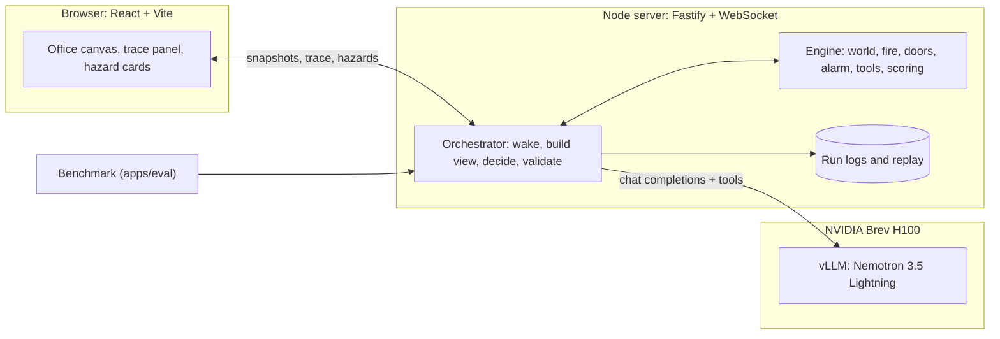

<p align="center">
  
</p>

<h1 align="center">Escape from Red Hat</h1>

<p align="center">
  <b>A pixel-art office evacuation drill. You start the fire and cut the power. NVIDIA Nemotron gets five people out through validated tool calls.</b>
</p>

<p align="center">
  <a href="https://huggingface.co/nvidia/NVIDIA-Nemotron-3.5-Lightning-30B-A3B-BF16"></a>
  <a href="deploy/vllm/serve.sh"></a>
  <a href="https://developer.nvidia.com/brev"></a>
  
</p>
<p align="center">
  
  
  
  
  
  <a href="LICENSE"></a>
  <a href="data/scenarios/DATASET_CARD.md"></a>
</p>

<p align="center">
  <a href="#quick-start">Quick start</a> ·
  <a href="#tech-stack-and-architecture">Tech stack</a> ·
  <a href="#how-to-reproduce-the-demo">Reproduce the demo</a> ·
  <a href="#results">Results</a> ·
  <a href="#datasets-and-synthetic-data">Datasets</a> ·
  <a href="#known-limitations-and-next-steps">Limitations</a>
</p>

---

A deterministic TypeScript engine owns a fictional office ground floor: six rooms, seven electric sliding doors, three exits, two fire-alarm pull stations, and a street with a bus-stop assembly point. You drop fires and power cuts. **Nemotron 3.5 Lightning 30B-A3B**, self-hosted on **vLLM**, decides what Alex (the warden), Maya, Daniel (who uses a wheelchair), Rosa (reception) and Kenji (IT) do, one native tool call at a time. The engine validates every call against the true world state, and a run only succeeds when every survivor is physically at the assembly point and the warden has verified the roster.

<p align="center">
  
</p>

- **One small open model.** 30B total and 3B active parameters, native tool calling, about 0.7 s per decision on one H100.
- **Two decision modes.** One central planner directs everyone (default), or each person makes their own reasoning call from only what they know (`PLANNER_MODE=agents`).
- **Honest by construction.** Rejected calls change nothing and return an error code with a hint. Engine reflexes are labelled as such, never as model decisions. The model cannot declare success.
- **Measured.** On held-out scenarios, the improved harness gets everyone out in 13 of 14 cases, against 9 of 14 for the baseline prompt ([results](#results)).

## Quick start

Requires Node 20 or newer (tested on 24) and npm. A GPU is only needed to self-host the model.

```bash
npm ci
cp .env.example .env    # runs a labelled scripted fixture by default, no key needed
npm run dev             # server on :8787, web app on :5173
```

Open http://localhost:5173 and click the glowing ground floor. To use Nemotron instead of the fixture, see [How to reproduce the demo](#how-to-reproduce-the-demo).

| Command | What it does |
|---|---|
| `npm test` | Engine and server tests (vitest) |
| `npm run bench -- --split test --provider env --harness v2 --out results/<dir>` | Headless benchmark on a dataset split |
| `npm run replay -- runs/demo-hero.jsonl` | Re-simulate a saved run without calling the model |
| `npm run data:map` / `npm run data:scenarios` | Rebuild the map / regenerate the scenario dataset (deterministic) |
| `npm run build && npm start` | Production build, served by the game server |

## Tech stack and architecture

| Layer | Technology |
|---|---|
| Model | NVIDIA Nemotron 3.5 Lightning 30B-A3B (BF16), the only generative model |
| Serving | vLLM 0.27.1 on one NVIDIA Brev H100 80GB, OpenAI-compatible API, `qwen3_coder` tool-call parser |
| Simulation | Pure, deterministic TypeScript engine (seeded fire spread, doors, alarm, pathfinding, perception, scoring) |
| Server | Node 24, Fastify, WebSocket |
| Web | React 19, Vite, Canvas 2D (vendored Pixel Agents renderer) |
| Evaluation | Headless benchmark, replay checker, baseline vs final comparison |



**One decision:** the engine wakes the planner only when someone notices something new. The model sees only what people have seen or been told and returns one tool call (`observe`, `consult_plan`, `notify`, `plan_route`, `move`, `request_assistance`, `assist`, `check_in`, `verify_roster`, `pull_alarm`). The engine executes it or rejects it with a reason.

```
apps/server       Fastify + WebSocket server, orchestrator, prompts, model providers
apps/web          React UI: canvas renderer, trace panel, hazard cards, roster
apps/eval         Benchmark, replay checker, comparison tool
packages/engine   Deterministic simulation (no I/O)
packages/contracts  Shared types, tool schemas, WebSocket protocol
data/             Map, synthetic scenario dataset, safety knowledge cards
deploy/vllm/      serve.sh, check.sh, model manifest
docs/             Serving and tool-calling details, demo runbook, images
results/          Benchmark summaries and replayable run logs
runs/             Saved live runs (demo-hero.jsonl is the backup replay)
```

Serving flags, latency and tool-calling details: [`docs/tech-stack.md`](docs/tech-stack.md).

## How to reproduce the demo

**1. Serve the model** on a Brev GPU VM (we used 1x H100 80GB). The API key is generated on the VM and never committed.

```bash
# On the VM: vLLM 0.27.1 with the exact flags used for the demo and results
./deploy/vllm/serve.sh
# On the laptop that runs the game server (keep it open)
brev port-forward escape-nemotron --port 8001:8000
```

**2. Configure `.env`** (sample below; full list in [`.env.example`](.env.example)). Keys stay on the server; the browser never receives them.

```dotenv
PLANNER_PROVIDER=openai-compatible
PLANNER_BASE_URL=http://127.0.0.1:8001/v1
PLANNER_MODEL=escape-nemotron
PLANNER_API_KEY=<ESCAPE_VLLM_KEY from the VM's server.env>
PLANNER_ENDPOINT_KIND=self-hosted-vllm
PLANNER_LABEL="Nemotron 3.5 Lightning 30B-A3B"
PLANNER_HARNESS=v2
PLANNER_MODE=central            # or agents: one reasoning call per person
```

| Variable | Default | Purpose |
|---|---|---|
| `PLANNER_API_KEY` | none | The vLLM `--api-key`, or an `nvapi-` key for the hosted NVIDIA API Catalog fallback |
| `PLANNER_BASE_URL` / `PLANNER_MODEL` | vLLM tunnel | Hosted fallback: `https://integrate.api.nvidia.com/v1` and `nvidia/nemotron-3.5-lightning-30b-a3b` |
| `PLANNER_MAX_DECISIONS` | `100` | Safety stop per run (there is no game timer) |
| `PLANNER_AGENT_THINKING_BUDGET` | `128` | Agents mode: reasoning tokens per decision (`0` = no cap) |
| `PLANNER_AGENT_FREEZE_WHILE_THINKING` | `true` | Agents mode: hold the sim clock while anyone thinks |
| `DEMO_CASE` | `demo-hero` | Scenario loaded on start and reset |

**3. Run the hero scenario.**

1. `npm run dev` and open http://localhost:5173. The server log should report `health: OK` for the model.
2. Drag **Fire** into the cubicles next to Maya. Maya shouts and Alex hears it; the other rooms do not.
3. Nemotron moves people out and sends someone to a pull station. The siren alerts the other rooms.
4. When someone crosses the hallway toward reception, drag **Electrical Failure** onto the reception door (or run `node scripts/auto-electrical.mjs` beforehand to do it on cue).
5. The move stops, the trace says why, and Nemotron re-routes through the west exit or the reception side door. Everyone crosses to the bus stop, checks in, and Alex verifies the roster.

Backup: `npm run replay -- runs/demo-hero.jsonl` re-applies a recorded live run without calling the model (shown with a REPLAY badge).

## Results

Held-out test split: 16 synthetic scenarios (14 normal, 2 trapped by design) with fires in rooms never used while tuning. Nemotron 3.5 Lightning on our vLLM, one H100, temperature 0.6, one run per case, measured 2026-10-18.

| Setup | Everyone out, normal cases | False success, trapped cases | People out | Invalid calls | Decisions per run | Decision latency p50 |
|---|---|---|---|---|---|---|
| Central planner, baseline prompt (v1) | 9/14 | 0/2 | 57/80 | 42.2% | 82.7 | 0.73 s |
| **Central planner, improved harness (v2)** | **13/14** | **0/2** | **77/80** | 32.6% | **29.9** | 0.73 s |
| Agents mode, one reasoning call per person | 12/14 | 0/2 | 76/80 | 11.7% | 61.1 | 1.08 s |

- The v2 harness adds a state digest, per-turn action masking and recovery hints. It was tuned on the dev split only (dev: 15/15). It is a prompt and harness improvement; no model weights were trained.
- No run ever claimed a false success, and there were no provider errors. Agents mode had 18 malformed replies in 977 decisions, each followed by a fresh decision.
- Single runs at temperature above 0 with a stochastic fire: a difference of one or two cases can be noise.
- Raw summaries and replayable logs: [`results/2026-10-18-office-v2-vllm-h100/`](results/2026-10-18-office-v2-vllm-h100/). Earlier rule sets and serving measurements: [`results/README.md`](results/README.md), [`docs/tech-stack.md`](docs/tech-stack.md).

## Datasets and synthetic data

| Data | Type | Provenance | Used for |
|---|---|---|---|
| [`data/scenarios/`](data/scenarios/DATASET_CARD.md) `escape-office-scenarios-v3` | Synthetic, generated during the event | `generator.ts` v3, master seed 20261017; 16 dev and 16 test cases with disjoint fire rooms; method, labels and hashes in the [dataset card](data/scenarios/DATASET_CARD.md) and `provenance.json`. CC BY 4.0 | Benchmark and scoring; `demo-hero` is the live demo |
| `data/maps/office-v2` | Synthetic, authored | `office-v2.ascii` plus `office-v2.spec.ts`, built by `data/maps/builder.ts`; original procedural pixel art for racks, cubicles, reception, kitchen and bus stop | Navigation truth for the engine and the renderer |
| `data/knowledge/` | Paraphrased public sources | 29 CFR 1910.36, 1910.37, 1910.38 and 1910.165 (U.S. government works); OSHA and NC DOL guidance, each with a source link. The site plan is fictional | `consult_plan` answers and the debrief |

Real datasets we considered and did not use (LEMTA drills, Juelich bottleneck trajectories, NIST stair egress, Raleigh building footprints) are listed with reasons in the dataset card.

## Known limitations and next steps

**Limitations**

- One fictional single-floor map. The fire is a simple seeded cellular spread, not fire science: no smoke, heat or injury model.
- Perception, earshot (same room only), the alarm and the central-mode reflexes (shout, back away, pull the alarm on the way out, no re-entry) are deterministic engine rules. Agents mode turns the reflexes off.
- 32 synthetic cases with one run each. Agents mode has one benchmark run and no claim that it beats the central planner.
- About 3% of agents-mode calls keep reasoning past the 128-token cap and run to about 1,100 tokens, which costs latency.
- Not compliance training and no building-code claims. Educational value is untested.

**Next steps**

- Import a customer's own floor plan through the map builder.
- More hazard types and occupants.
- Several samples per case to tighten the baseline vs final gap.
- Per-person rewards from the engine's run logs, as groundwork for RL fine-tuning of a warden policy.

## License and attribution

Code: MIT ([LICENSE](LICENSE)). Scenario dataset: CC BY 4.0. Pixel Agents renderer (MIT, vendored at `3537e14`), character sprites based on JIK-A-4 Metro City (CC0), fonts under OFL 1.1: see [THIRD_PARTY_NOTICES.md](THIRD_PARTY_NOTICES.md).

Built at the NVIDIA x Red Hat Small Models Hack, Raleigh, October 17 to 18, 2026. Hackathon rules: all code written during the event; reused open source is at least two weeks old (Pixel Agents `3537e14`, vLLM `v0.27.1`, npm pinned by `.npmrc`); one generative model at 30B total parameters ([model manifest](deploy/vllm/MODEL_MANIFEST.md)).

"Red Hat" and "NVIDIA" are trademarks of their owners. This is a fictional, hackathon-themed office, not affiliated with or endorsed by Red Hat or NVIDIA.
