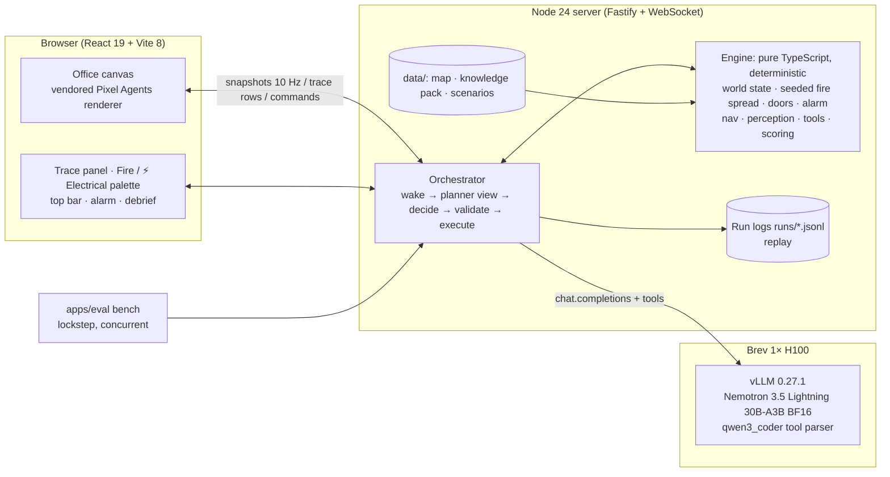

# Escape from Red Hat

**A pixel-art workplace evacuation exercise where you change the emergency and watch AI-controlled characters respond.**

- **The setting.** A fictional office ground floor: a green NVIDIA GPU server room, a Red Hat conference room, a kitchen, the main hallway, cubicles and a reception lobby, joined by seven electric sliding doors, with three manual exits. Outside is a street; everyone meets across it, at the bus stop.
- **The model.** A single small open model, **NVIDIA Nemotron 3.5 Lightning 30B-A3B** served with **vLLM**, picks real, validated tool calls for five characters — either as one *central planner* (default, benchmarked) or, with `PLANNER_MODE=agents`, as **five separate reasoning calls, one per person**, each seeing only what that person knows:
  - Alex, the warden;
  - Maya, an employee;
  - Daniel, a visitor who uses a wheelchair;
  - Rosa, the receptionist at the front desk;
  - Kenji, the IT engineer who works in the GPU server room.
- **What you do.** Drag in one or more **fires** — they spread from tile to tile — and **⚡ electrical failures** that jam an interior sliding door shut.
- **What you see.** Fire spreads tile by tile, climbs walls and works its way through the building. People react like people: whoever sees or smells it shouts "Fire!" to their own room, anyone close backs away from the flames, someone heading out past one of the two **fire-alarm pull stations** (main hallway, reception) pulls it (siren and strobes reach every room), and nobody goes back inside once out. These *instincts* are engine rules, labelled as such. **The model** does the planning: it decides who goes where and by which exit, sends someone to the alarm when people elsewhere are still unaware, re-routes around jammed doors, can honour Daniel's buddy arrangement, and verifies everyone at the assembly point. Anyone the fire reaches is **lost** (they disintegrate). A live trace tells the story in plain language, with every model call shown.
- **What the engine guarantees.** A deterministic, seeded engine owns the world, including the fire. The model can't walk anyone into fire they know about or declare success; only a verified roster can. There is no time limit: the run ends when every survivor is accounted for, or when everyone is lost.

Main track: **Tool-Calling**. Built at the NVIDIA × Red Hat Small Models Hack, Raleigh, Oct 17–18 2026.

**How we use Nemotron Lightning, Brev + vLLM and tool calling, with measured evidence and next steps: [`tech-stack.md`](tech-stack.md).**

- Demo video: _link to be added_ (unlisted YouTube)
- Screenshot: _to be added_ (`docs/screenshot.png`)

> **What we claim, and what we don't.**
> - We claim tool-use reliability of a small model in a simulated exercise.
> - We do **not** claim training effectiveness, realistic human behaviour, real fire dynamics (the fire is a simple seeded cellular spread), building-code compliance, or an operational emergency system.

---

## Quick start

Requirements: Node ≥ 20 (tested on 24) and npm. A GPU is only needed to self-host the model (see below).

```bash
npm ci
cp .env.example .env          # PLANNER_PROVIDER=scripted works with no key
npm run data:map              # rebuild data/maps/office-v2.json (already committed)
npm run dev                   # server :8787 + web :5173
open http://localhost:5173
```

**Two modes.** Scripted mode is a labeled fixture: the UI says **SCRIPTED — not a model**. Use it for UI work only. For the real planner, point `.env` at Nemotron (see [Reproduce the demo](#how-to-reproduce-the-demo)).

**Other commands:**

```bash
npm test                      # engine + server tests (vitest)
npm run data:scenarios        # regenerate the scenario dataset (deterministic)
npm run bench -- --split dev  # headless benchmark → results/<run>/summary.md
npm run replay -- runs/<episodeId>.jsonl   # re-simulate a saved run and check it reproduces
npm run build && npm start    # production: server also serves the built web app
```

## Tech stack and architecture



| Component | What it does |
|---|---|
| `packages/contracts` | Shared types; 10 tool JSON Schemas (sent to the model) and zod validators (enforced); WebSocket protocol |
| `packages/engine` | Authoritative simulation: 100 ms ticks, seeded stochastic fire spread, electric sliding doors, fire-alarm pull stations, 4-connected pathfinding, wheelchair-clearance mask, line-of-sight perception, tool validation and effects, losses, outcomes, metrics, debrief, state hash. No I/O, seeded RNG only |
| `apps/server` | Fastify + `@fastify/websocket`. Episode lifecycle (pause/reset/replay), the planner loop, decision providers (`openai-compatible` for vLLM / NVIDIA API Catalog, plus a labeled `scripted` fixture), prompt and harness, run logs |
| `apps/web` | React 19 + Vite 8. Pixel Agents' Canvas 2D renderer (vendored @3537e14, patched so the engine drives every character). Overlays for names, speech bubbles and the placement ghost; trace; palette (drag-drop, click-to-place, keyboard) |
| `apps/eval` | Headless benchmark, replay checker, baseline-versus-final comparison |
| `data/` | Map (ASCII to JSON), knowledge pack (OSHA / NC DOL, paraphrased with links), synthetic scenario dataset |
| `deploy/vllm` | `serve.sh`, `check.sh`, Brev runbook, model manifest |

**Tools the model can call:** `observe`, `consult_plan`, `notify`, `plan_route`, `move`, `request_assistance`, `assist`, `check_in`, `verify_roster`, `pull_alarm`.

- `notify` is spoken: it reaches only people in the same room (a doorway joins the two rooms it connects; outside is one area). Anyone elsewhere is not reached, and a call with nobody in earshot is rejected with `OUT_OF_RANGE`. People already shout "Fire!" to their own room by instinct, so the model uses `notify` for route news and for people it meets in person.
- `pull_alarm` only works for someone standing at a pull station — one in the main hallway, one in reception (`move` to destination `"alarm"` goes to the nearest). It is the only way to alert people in other rooms, but, like a real alarm, says nothing about *where* the fire is. People who pass the station on their way out pull it by instinct.
- Once someone is outside, `move` and `plan_route` back into the building are rejected (`NOT_AUTHORIZED`): nobody goes back into a burning building.
- Invalid calls return structured errors and never change the world. Codes include `ROUTE_UNAVAILABLE`, `STALE_STATE`, `ACTOR_BUSY`, `OUT_OF_RANGE`, `ASSISTANCE_NOT_ACCEPTED` and `NOT_AUTHORIZED`.
- The planner sees each character's observations and reports, but never fire cells or jammed doors nobody has seen.
- Each character can only act on what *they* know. Someone who hasn't been alerted (by the alarm or by a person) can't evacuate yet.
- Lost characters can no longer act.

**Rendering.** A fixed ¾-view pixel diorama, top-down with z-sorting. It is not isometric or 3D.

## How to reproduce the demo

### 1. Serve the model (self-hosted, used for the submitted demo and results)

On a Brev GPU VM (we used 1× H100 80GB HBM3), run [`deploy/vllm/serve.sh`](deploy/vllm/serve.sh) — the exact command used for the demo and results (runbook: [`deploy/vllm/README.md`](deploy/vllm/README.md)):

```bash
# GPU VM (key generated once into $ESCAPE_ROOT/server.env; never committed)
docker run -d --name escape-nemotron --restart unless-stopped --gpus all --ipc=host -p 127.0.0.1:8000:8000 \
  -v "$ESCAPE_ROOT/hf-cache:/root/.cache/huggingface" -v "$ESCAPE_ROOT/vllm-cache:/root/.cache/vllm" \
  vllm/vllm-openai:v0.27.1 --model nvidia/NVIDIA-Nemotron-3.5-Lightning-30B-A3B-BF16 \
  --served-model-name escape-nemotron --dtype bfloat16 --max-model-len 8192 --max-num-seqs 8 \
  --max-num-batched-tokens 8192 --gpu-memory-utilization 0.90 --enable-prefix-caching --async-scheduling \
  --mamba-backend flashinfer --mamba-ssm-cache-dtype float16 \
  --enable-mamba-cache-stochastic-rounding --mamba-cache-philox-rounds 5 \
  --reasoning-parser nemotron_v3 --tool-call-parser qwen3_coder --enable-auto-tool-choice \
  --api-key "$ESCAPE_VLLM_KEY"

# Laptop running the game backend (keep it open):
brev port-forward escape-nemotron --port 8001:8000
```

Development fallback with the same weights: the hosted NVIDIA API Catalog (see env table below). Results from it are labeled "hosted".

### 2. Configure `.env` (keys stay on the server; the browser never sees them)

| Variable | Example | Meaning |
|---|---|---|
| `PLANNER_PROVIDER` | `openai-compatible` | `scripted` = labeled fixture, not a model |
| `PLANNER_BASE_URL` | `http://127.0.0.1:8001/v1` | vLLM via `brev port-forward`. Hosted: `https://integrate.api.nvidia.com/v1` |
| `PLANNER_MODEL` | `escape-nemotron` | vLLM `--served-model-name`. Hosted: `nvidia/nemotron-3.5-lightning-30b-a3b` |
| `PLANNER_API_KEY` | `<ESCAPE_VLLM_KEY>` | vLLM `--api-key` (from the VM's `server.env`), or an `nvapi-…` key for the hosted catalog |
| `PLANNER_ENDPOINT_KIND` | `self-hosted-vllm` | or `hosted-api`; shown in the UI and in results |
| `PLANNER_LABEL` | `Nemotron 3.5 Lightning 30B-A3B` | display name |
| `PLANNER_THINKING` | `false` | reasoning off for latency (A/B option) |
| `PLANNER_TEMPERATURE` / `PLANNER_TOP_P` | `0.6` / `0.95` | sampling |
| `PLANNER_MAX_TOKENS` | `1024` | per decision (raise if thinking is on) |
| `PLANNER_DEADLINE_MS` | `30000` | per-decision timeout (hosted catalog needs ~120000) |
| `PLANNER_FREEZE_WHILE_THINKING` | auto | live mode: hold the sim clock during inference (default on for hosted APIs) |
| `PLANNER_MAX_DECISIONS` | `100` | per-episode decision cap — a safety stop, not a game rule (there is no time limit) |
| `PLANNER_HARNESS` | `v2` | prompt/harness version (`v1` = baseline) |
| `PLANNER_MODE` | `central` | `agents` = each person makes their own reasoning call from their own view; engine instincts off |
| `PLANNER_AGENT_THINKING` / `PLANNER_AGENT_THINKING_BUDGET` / `PLANNER_AGENT_MAX_DECISIONS` / `PLANNER_AGENT_FREEZE_WHILE_THINKING` | `true` / `128` / `250` / `true` | agents-mode settings (the central ones are left alone); the budget caps reasoning tokens per decision (vLLM `thinking_token_budget`, `0` = no cap) |
| `PORT` | `8787` | server port |
| `DEMO_CASE` | `demo-hero` | scenario loaded on start/reset |

### 3. Run the hero scenario

1. `npm run dev`, then open http://localhost:5173. On the start screen, click the glowing ground floor of the (pixel-art) tower or press Enter; add `?intro=0` to the URL to skip it. Check that the top bar shows **Nemotron · self-hosted vLLM** and that the model is healthy.
2. Watch the idle office. No model calls happen before an incident.
3. Drag **Fire** into the cubicles beside Maya. It starts spreading, and given time it climbs the walls and moves into the next rooms.
4. Maya sees it and shouts "Fire!" (instinct), so Alex, in the same room, hears it and both back away from the flames. Daniel (Red Hat room), Rosa (reception) and Kenji (server room) hear nothing. Follow the trace: Nemotron moves people out and gets someone to a **fire-alarm pull station** (a person whose way out passes one pulls it on the way). The siren and red strobes are what alert the other rooms.
5. When someone crosses the main hallway toward reception, drag **⚡ Electrical failure** onto the **reception door** (between the hallway and the reception lobby, on the way to the main entrance).
6. Their move stops safely and the trace shows why ("the reception door is dead"). Nemotron re-plans through the cubicles and the reception side door, or out of the west exit and along the sidewalk, away from the fire. Nobody goes back inside. Everyone crosses at the crosswalk to the bus stop and checks in, and Alex runs `verify_roster`.
7. Read the debrief. Use **Reset** to start again. To see losses, drop a fire right next to someone who hasn't been alerted.

Rehearsal helper: `node scripts/auto-electrical.mjs` drops the electrical failure on cue (step 5) so a solo presenter can run the hero scenario (`--door` and `--when-zone` pick another door or trigger).

**Replay a saved run** (labeled **REPLAY** in the UI): `npm run replay -- runs/demo-hero.jsonl`. This re-applies the recorded decisions without calling the model.

**Benchmark:** `npm run bench -- --split test --harness v2 --concurrency 4 --out results/test-v2` · all vLLM evidence in one go: `API_KEY=… deploy/vllm/measure.sh full`.

## Datasets and synthetic data (with provenance)

| Data | Type | Provenance and licence | How it is used |
|---|---|---|---|
| `data/scenarios/` **escape-office-scenarios-v3** | **Synthetic**, generated during the event (2026-10-17/18) | `generator.ts` v3, master seed 20261017. Families: fire_only, multi_fire, fire_then_door, independent, trapped. Method, fields and limits are in [`DATASET_CARD.md`](data/scenarios/DATASET_CARD.md); hashes in `provenance.json`. CC BY 4.0 | The app boots `demo-hero`. The benchmark runs and scores 16 dev and 16 held-out test cases (test uses fire locations never seen in dev) |
| `data/maps/office-v2` | Synthetic (authored) | `office-v2.ascii` plus `office-v2.spec.ts`, built by `data/maps/builder.ts`: 44×29 tiles, six rooms, 7 interior electric sliding doors, 3 manual exits, 2 fire-alarm pull stations (main hallway, reception), a street with a crosswalk and a bus-stop assembly point. GPU racks, cubicles, the reception desk, the kitchen and the bus shelter are original procedural pixel art; other furniture footprints come from the vendored Pixel Agents manifests | Shared by the engine (navigation truth) and the renderer |
| `data/knowledge/` | Paraphrased public sources | 29 CFR 1910.36(d)(1), 1910.37(a)(3), 1910.38(c)–(f), 1910.165 (U.S. government works); OSHA *Getting Started* guidance; NC DOL EAP pages. Each card has a source URL, checked 2026-10-17. The site plan is **fictional** | `consult_plan` answers and the debrief's cited lessons |

**Considered but not integrated:** LEMTA evacuation drills, Jülich bottleneck trajectories, NIST stair egress, and Raleigh building footprints. Reasons are in the dataset card. No real measurement is presented as describing this office.

## Results

**Current game: the office-v2 ground floor, five people.** Measured on 2026-10-18 with **Nemotron 3.5 Lightning 30B-A3B (BF16) on our vLLM 0.27.1, one Brev H100 80GB**, temperature 0.6, decision cap 100 (safety stop), lockstep clock, **one run per case** — temperature > 0 *and* a seeded stochastic fire, so differences of 1–2 cases can be noise. Central planner: thinking off, concurrency 4. Per-agent mode: reasoning on, capped at 128 tokens per decision, concurrency 1 (the server was still on `--max-num-seqs 4`, so running several five-person episodes at once would mostly have measured queueing). Raw summaries and replayable run logs (`runs.tar.gz`): [`results/2026-10-18-office-v2-vllm-h100/`](results/2026-10-18-office-v2-vllm-h100/).

**Held-out test split** (16 cases: 14 normal + 2 trapped-by-design; fire rooms never used while tuning — the GPU server room, the main hallway and reception):

| Decision mode / harness | Verified success, normal cases | False success, trapped cases | People escaped | People lost | Mean reward | Invalid-call rate | Repeated identical invalid calls | Decisions / episode | Decision p50 / p95 |
|---|---|---|---|---|---|---|---|---|---|
| Central, v1 baseline — static tools, raw state JSON | 6/14 | 0/2 | 57/80 | 8 | −1.00 | 47.4% (671/1416) | 193 | 88.5 | 699 / 1053 ms |
| **Central, v2 — state digest, per-turn action masking, recovery hints** | **14/14** | **0/2** | **78/80** | 2 (trapped cases only) | **+0.63** | 31.5% (143/454) | **33** | **28.4** | 703 / 984 ms |
| Per-agent — five reasoning calls, personal views, no engine instincts | 12/14 | 0/2 | 76/80 | 4 | +0.56 | 9.2% (84/917) | 8 | 57.7 | 1050 / 1737 ms |

- **Dev split** (tuning split; the v2 harness and the agent prompt were tuned on office-v1's dev split, and for this map only adapted — place names, exits, examples — not re-tuned on results): central v2 15/15 normal successes, 79/80 escaped; per-agent 15/15, 79/80 escaped.
- **Baseline → v2 on the test split:** 6/14 → 14/14, people lost on normal cases 6 → 0, a third of the decisions, a sixth of the repeated invalid calls, and the alarm pulled 13.6 s after the first sighting instead of 45.4 s. Per-case comparison: [`compare-test-v1-vs-v2.md`](results/2026-10-18-office-v2-vllm-h100/compare-test-v1-vs-v2.md).
- **No false successes** in any run, and **zero provider errors**. Malformed responses: 0 for the central planner; 10 of about 1,700 per-agent decisions (4 dev, 6 test), each recorded and followed by a fresh decision.
- **Per-agent mode** reaches about the same outcomes with no engine instincts and far fewer rejected calls, but makes about twice as many decisions per episode, and each one takes about 1.1 s instead of 0.7 s (reasoning). It has not been compared with the central planner beyond this one run per case.
- **Prompt size:** central v2 prompts are about 5.2–5.4K tokens (median), at most 6.2K; per-agent prompts about 3.1–3.2K, at most 3.8K, plus up to 128 reasoning tokens. About 2–3% of per-agent calls keep reasoning in the visible reply after the cap and run to ~1,000 completion tokens; they still parse.

**History: office-v1, three people (ruleset 3: room-limited voice, one hallway alarm, survival instincts, fire that burns through walls).** Measured on 2026-10-17 on the same server, thinking off, decision cap 60, concurrency 4, one run per case, before the fire was made to spread faster. Raw summaries: [`results/2026-10-17-ruleset3-vllm-h100/`](results/2026-10-17-ruleset3-vllm-h100/). Held-out test split (14 normal + 2 trapped):

| Harness | Verified success, normal cases | False success, trapped cases | People escaped | People lost | Mean reward | Invalid-call rate | Repeated identical invalid calls | Decisions / episode | Decision p50 / p95 |
|---|---|---|---|---|---|---|---|---|---|
| v1 baseline | 6/14 | 0/2 | 23/48 | 1 | −1.00 | 50.9% (441/866) | 184 | 54.1 | 713 / 1117 ms |
| v2 | 11/14 | 0/2 | 37/48 | 2 | 0.00 | 51.9% (200/385) | 63 | 24.1 | 720 / 1174 ms |

v2 was tuned on the dev split only (dev, v2: 14/15 normal successes, 0/1 false success, 44/48 escaped); the test split was run once per harness after tuning stopped. Per-case comparison: [`compare-test-v1-vs-v2.md`](results/2026-10-17-ruleset3-vllm-h100/compare-test-v1-vs-v2.md). Earlier rule sets (history): ruleset 2 [`results/2026-10-17-ruleset2-vllm-h100/`](results/2026-10-17-ruleset2-vllm-h100/) (v1 6/14 → v2 9/14), ruleset 1 below. Per-agent mode was not benchmarked on office-v1; a few hand runs with uncapped reasoning took 2.5–3.4 s per decision (p95 12.5–15 s), and a live run with the clock running during inference lost everyone, which is why per-agent mode holds the clock while anyone is thinking.

**Ruleset 1 (history: static fire + "blocker", 240 s limit, buddy arrangement required).** Measured on 2026-10-17 with **Nemotron 3.5 Lightning 30B-A3B (BF16) served by our vLLM 0.27.1 on one Brev H100 80GB**, thinking off, temperature 0.6, decision cap 40, lockstep clock, concurrency 4, **one run per case** (temperature > 0, so differences of 1–2 cases can be noise). Raw summaries and replayable run logs: [`results/2026-10-17-vllm-h100/`](results/2026-10-17-vllm-h100/).

**Harness improvement on the held-out test split** (16 cases; fire locations never used while tuning; same model, server and config):

| Harness | Verified success (solvable) | False success (unsolvable) | Invalid-call rate | Repeated identical invalid calls | Mean reward | Decisions / episode | Decision p50 / p95 |
|---|---|---|---|---|---|---|---|
| v1 baseline — static tools, raw state JSON | 5/14 | 0/2 | 26.8% (164/611) | 64 | −0.50 | 38.2 | 668 / 1002 ms |
| **v2 final — state digest, per-turn action masking, recovery hints** | **12/14** | **0/2** | **9.6% (43/448)** | **15** | **+0.69** | **28.0** | 670 / 1148 ms |

Per-case comparison: [`compare-test-v1-vs-v2.md`](results/2026-10-17-vllm-h100/compare-test-v1-vs-v2.md). v2 was tuned on the **dev** split only (dev, v2: 14/14 solvable successes, 0/2 false successes, 18.6% invalid calls); the test split was run once per harness after tuning stopped.

What "verified success" meant in ruleset 1: all three characters physically checked in at the assembly point, Daniel's agreed buddy arrangement carried out, and the warden's `verify_roster` confirming it. Unsolvable cases (no real route) had to end `unresolved`; neither harness ever produced a false success.

**Outcomes in ruleset 2** (the model cannot declare any of these itself):

| Outcome | When |
|---|---|
| `success` | All three alive, physically checked in at the assembly point, and the warden's `verify_roster` confirms it. Daniel's buddy arrangement is good practice but optional |
| `partial` | Someone was lost to the fire, and every survivor is checked in and accounted for (verified by Alex, or Alex was lost) |
| `failed` | Everyone was lost |
| `incomplete` / `unresolved` | Safety stops only (decision cap; a stall guard in headless runs) — `unresolved` when survivors are trapped with no real route. There is no time limit |

Trapped-by-design test cases (`expectLosses`) must never end in `success`.

## How NVIDIA Nemotron, vLLM and NeMo Gym are used

**Nemotron 3.5 Lightning 30B-A3B** is the only generative model (30B total parameters ≤ the 33B cap; no draft, critic or router model).
- It is the central planner: each decision is one native tool call for one named character, executed by a deterministic engine that validates it against world truth.
- Why it: a small open model with native tool calling whose 3B-active MoE keeps a central decision at ~0.7 s on one H100 — fast enough for a live scene.
- How we optimised it (measured above): a compact planner view; strict schemas; structured errors with actionable hints; thinking off; and the **v2 harness** — a short state digest (who is in danger near known fire, waiting, busy; open items), per-turn **action masking** (each tool's `actor_id` options list only people who can act now), and wake-ups only on genuinely new information. Held-out v1 → v2 (current rules): 6/14 → 11/14 verified successes, 23 → 37 of 48 people escaped, 54 → 24 decisions per episode, 184 → 63 repeated rejected calls; earlier rule sets: 6/14 → 9/14 and 5/14 → 12/14.

**vLLM 0.27.1** serves the model on one Brev H100 (80GB HBM3) through the OpenAI-compatible API — it is the only path the submitted demo and results use.
- Native tool calls via the `qwen3_coder` parser (100% of measured responses parsed natively; 0 malformed), reasoning separation via `nemotron_v3`.
- Configured for this workload, not copied blindly: BF16 card recipe + `--max-model-len 8192` (central prompts ≈ 5.3K tokens median, at most 6.2K, on the five-person ground floor), `--max-num-seqs 8` (five people decide in parallel in agents mode), prefix caching (system prompt + tools are a shared ~3K-token prefix), API key, bound to localhost and reached through `brev port-forward`.
- Measured on the office-v2 benchmark: central decision latency p50 ≈ 0.70–0.73 s, p95 ≈ 1.0 s; per-agent (reasoning capped at 128 tokens) p50 ≈ 1.05–1.12 s, p95 ≈ 1.7–2.2 s. Weights 58.9 GiB, KV cache 9.3 GiB. Throughput and cache numbers: [`deploy/vllm/MODEL_MANIFEST.md`](deploy/vllm/MODEL_MANIFEST.md).
- We use upstream vLLM because Red Hat AI Inference 3.5.1 packages vLLM 0.24.0, older than this model requires (0.27.1).

**NeMo Gym 0.6.0** (released 2026-09-09): [`gym/`](gym/) wraps this same engine as a Resources Server — tasks from the dataset's dev/test splits, the tools as Gym tool routes (ruleset 2 adds `pull_alarm`; task rows are regenerated with `gym/make_tasks.ts`), and `verify()` returning the engine's reward (+1 verified success with procedures, 0 incomplete, −1 critical violation). It runs through the real nemo-gym classes (tests pass); full Gym rollout collection against our vLLM is documented there. The baseline-vs-final numbers above come from our own bench runner over the same engine and scoring. **The improvement is a prompt/harness improvement, not RL — no model weights were trained.**

## Known limitations and next steps

**Limitations:**
- One fictional single-level map (the office-v2 ground floor) with five characters, seven interior sliding doors, three exits and two pull stations.
- The fire is a simple seeded cellular spread (each burning tile occasionally ignites a random neighbour; doorways and walls slow it, walls burn through after a while; tiles burn out into impassable debris). It is not fire science: no smoke plume, heat, toxicity, ventilation or injury model — "lost" is a game state.
- Perception, smelling smoke through a nearby wall, earshot (same room only), the alarm and — in central mode only — the survival instincts (shout, back away, pull the alarm on the way out, no re-entry) are simple deterministic rules, shown in the trace as instincts rather than model decisions. In per-agent mode the instincts are off and each person decides those things themselves. The alarm reaches everyone instantly.
- Default mode: a central planner controls all five characters. Per-agent mode (`PLANNER_MODE=agents`) gives each person their own reasoning call and view. It has one benchmark run per case (12/14 normal test successes vs the central planner's 14/14) and we make no claim that it is better than the central planner. It caps reasoning at 128 tokens per decision (`PLANNER_AGENT_THINKING_BUDGET`) and by default holds the sim clock while anyone thinks.
- Benchmark: 32 synthetic cases, a single run per case, temperature > 0, and a seeded stochastic fire. Treat differences of one or two cases as noise. The v2 harness was tuned on dev; it narrows the tool menu each turn (action masking), which is part of what is being measured.
- Educational value is a hypothesis; no learning outcomes were measured. Not compliance training; no building-code claims.
- Replays re-apply recorded decisions. A fresh run with the same seed can make different model choices.

**Next steps:**
- Import a customer's own floor plan.
- More hazard types and occupants.
- Gym rollout collection at scale (multiple samples per case) to tighten the confidence on the v1→v2 gain.
- RL fine-tuning of a warden policy, once trainer and hardware compatibility is confirmed.
- A study of whether watching runs actually helps people learn.

## Team

| Name | Role | Contact |
|---|---|---|
| _to fill_ | Engine / planner lead | _to fill_ |
| _to fill_ | Inference / evaluation lead | _to fill_ |
| _to fill_ | Frontend / visual lead | _to fill_ |

## Licences and attribution

- Our code: MIT ([LICENSE](LICENSE)). Scenario dataset: CC BY 4.0.
- Pixel Agents renderer and assets: MIT © 2026 Pablo De Lucca, vendored at commit `3537e14`. Character sprites are based on JIK-A-4 *Metro City* (CC0).
- Fonts (Inter, Pixelify Sans, Press Start 2P): OFL 1.1.
- Full details: [THIRD_PARTY_NOTICES.md](THIRD_PARTY_NOTICES.md).

**Trademark notice.** "Red Hat" and "NVIDIA" are trademarks of their owners. This is a fictional, hackathon-themed office, **not** affiliated with or endorsed by Red Hat or NVIDIA, and not an official training product.

## Hackathon rule compliance

| Rule | How we meet it |
|---|---|
| Code written during the event | All project code was written during the event, starting 2026-10-17 |
| Reused open source must be ≥ 2 weeks old | Pixel Agents is pinned to commit `3537e14` (2026-08-15). The vLLM image is `v0.27.1` (released 2026-08-11). npm dependencies resolve with `before=2026-10-03` in `.npmrc`; check with `npm run deps:audit` |
| ≤ 33B total generative parameters | One model, 30B total. No draft, critic or router models (`deploy/vllm/MODEL_MANIFEST.md`) |
| Meaningful open data | The published synthetic scenario dataset `escape-office-scenarios-v2` (with method), which drives the app and the scorer, plus the source-linked public knowledge pack |
